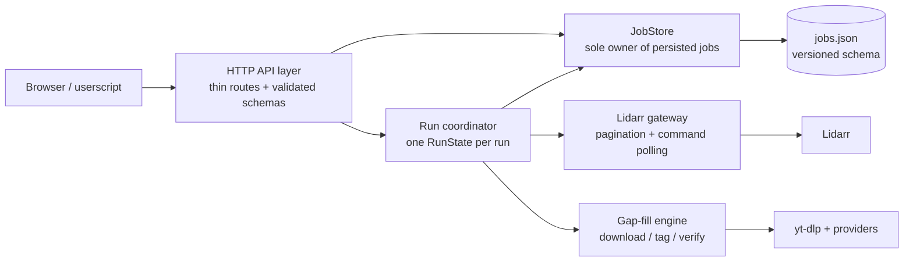

# Architecture review and fragility reduction plan

Status: implementation in progress on branch `refactor/fragility-redesign` (see `docs/architecture.md` for the implemented shape).

Scope: the Blissful Flask app in this repository (single container, single persistent
volume, home-server scale). The six uncommitted modified files in the working tree
(`wanted-search.md`, `job_manager.py`, `downloads.js`, `wanted.js`,
`downloads_tab.html`, `test_blissful.py`) were treated as read-only and are out of
scope for this plan's first commit.

## Verdict

The application is fragile for one main reason and three reinforcing reasons:

1. **A single logical operation ("run") has no single owner.** Its state is spread
   across `JobManager` (JSON file), `WantedSearchService` (in-memory snapshot, per-kind
   locks, cancel events, job-id sets), `DownloadManager` (thread-local progress
   context), and `FailedImportsRetry` (its own terminal-status set). Every regression
   in the recent history is a divergence between two of those copies.
2. **Orchestration is implemented as several god methods** with duplicated policy
   constants and ad-hoc polling helpers, so one change touches many distant places.
3. **The UI treats the DOM as state** and rebuilds it wholesale on polls, so transient
   state (expansion, focus, selection, scroll, toast lifecycle) must be manually
   reconstructed every tick.
4. **The safety net is an illusion**: `py -3.11 -m pytest -q` reports 131 passed, but no
   CI workflow runs tests, 9 of those tests always pass regardless of their result,
   and most assertions target hand-rolled stubs of private methods rather than real
   persisted state or HTTP contracts.

Evidence of the churn: `wanted_search.py` has 30 commits, most of them fixes to
earlier fixes (`fix: cancelled ... finish cancelled, not failed`, `fix: unstick
retries ...`, `fix: show search progress ...`, `fix: queue repeat runs ...`). The
working tree already contains another fix to `_mirror_child_progress_locked()`, the
same parent/child progress-mirroring class of bug.

## Root causes (with locations)

### 1. Split-brain run state — highest severity

| State | Owner | Location |
|---|---|---|
| Job records, status, log, parent/child links | `JobManager` | `extend/job_manager.py:19`, `:73-110`, `:424-450` |
| Active run snapshot | `WantedSearchService` | `extend/wanted_search.py:211-221`, `:496-514` |
| Per-kind locks / cancel events / job ids | `WantedSearchService` | `extend/wanted_search.py:214-218` |
| Current download source/attempts | `DownloadManager` | `extend/download_manager.py:64-66`, `:332-375` |
| Lidarr terminal statuses (second definition) | `FailedImportsRetry` | `extend/failed_imports.py:69-71` |

Consequences already observed and documented in the maintenance skill:

- `terminate` status sets must be manually synced (`job_manager.py:19` vs
  `failed_imports.py:69`); forgetting one makes `_poll_job()` spin to timeout.
- Cancellation must find children by run id, by `parent_id`, and by the per-kind id
  set, in a specific order (`wanted_search.py:433-461`).
- The final status write has to check the run's cancel event separately or it
  overwrites cancelled children with `failed` (`wanted_search.py:1057-1070`).
- `cleanup_stale()`'s `finally` defaults to `'failed'` while `search()`'s defaults to
  `'completed'` (`wanted_search.py:407-409` vs `:375-378`).
- Run kind is inferred from a thread-local, then `_last_kind`, then `'search'`
  (`wanted_search.py:463-471`, `:496-505`); child callbacks run on worker threads, so
  progress must be re-derived by parsing the `source` string
  (`wanted_search.py:247-257`). This is the documented "phantom cleanup" bug class.
- `queue_requested_run()` uses `time.time()` as a dedupe key
  (`wanted_search.py:423`), so queued runs deliberately never dedupe.

### 2. Orchestration god methods and duplicated policy

- `_search_impl()` spans `wanted_search.py:1071-1412` (~340 lines);
  `_cleanup_impl()` spans `:1604-2075` (~470 lines);
  `FailedImportsRetry.gapfill_album()` spans `failed_imports.py:468-708` (~240 lines).
- `UNHEALTHY_PATTERNS`, `_COMMAND_TERMINAL`, `_lower()`, `_record_text()` and naming
  defaults exist in both `wanted_search.py:70-118` and `failed_imports.py:38-102`;
  naming defaults also in `naming.py:16-17`.
- `_poll_command()` is implemented independently in
  `wanted_search.py:1424-1471` and `failed_imports.py:453-466`.
- `Blissful.py:90-120` constructs 15 managers at import time and passes 14 of them
  into `register_routes()` (`extend/routes.py:14`); there is no app factory, so tests
  build a different, stubbed Flask app.

### 3. Frontend state and lifecycle fragmentation

- Nine plain scripts are loaded in a fixed order (`templates/index.html:95-103`),
  all symbols are globals, and inline `onclick` handlers in the templates freeze those
  names into HTML. `node --check` cannot detect a broken cross-file reference.
- `renderJobs()` clears `list.innerHTML` on every 5 s poll
  (`static/js/downloads.js:111`, `:826`); `renderJobDetails()` clears the pane on every
  1.5 s poll (`:784`). Expanded state is positional (`detailsOpenSet`, `:234`,
  `:659-664`), and autoscroll is reconstructed with `wasAtBottom` (`:511-512`, `:725`).
- Toast lifecycle is split between `wantedActiveShown` (`wanted.js:44`),
  `wantedToastState` (`:67`), the poll's local `sawActive` (`:155-158`), and a second
  implementation in `config.js:340-353`.
- Config load/save are two hand-mirrored DOM schemas (`config.js:83-175` and
  `:192-242`); source priorities are reconstructed from `<strong>`/`<small>`
  `textContent` (`sources.js:250-257`), so markup changes can silently corrupt saves.
- Five uncoordinated timers with no in-flight guard or request sequencing
  (`downloads.js:826`, `:784`, `wanted.js:160`, `:490`, `config.js:413`).

### 4. Tests and CI do not constrain the architecture

- `py -3.11 -m pytest -q`: **131 passed**, 31 s (baseline recorded during this review).
- 9 of those tests `return bool` instead of asserting (`extend/test_api.py` 7,
  `extend/test_setup.py` 2), so pytest warns and they pass unconditionally.
- ~104 locally defined test doubles, including ~33 copies of `class Config` in
  `tests/test_blissful.py`; the 11-argument `register_routes` stub block is copied five
  times (`:918-923`, `:1006-1010`, `:1245-1249`, `:1376-1380`, `:1407-1411`).
- `Jobs.update_job`/`get_job` stubs (`:1595-1617`, `:1465-1471`) write into a dict the
  test then asserts on — self-proving tests for the exact state writes that keep
  breaking in production.
- Roughly 5 of ~40 routes have any HTTP-level exercise; none assert a response
  contract. ~59 assertions poke private methods (`_set_active`, `_finish_active`,
  `_process_due_retries`, `_next_pending`, `_finish_job`, ...).
- Two import layouts load duplicate module objects: `tests/test_metadata_order.py:6-11`
  imports flat `config_manager`, so `ConfigManager is not extend.config_manager.ConfigManager`.
- Neither `.github/workflows/docker-publish.yml` nor `upstream-check.yml` runs pytest
  or `node --check`. `tests/synthetic/mock_lidarr.py` is never used.

## Target architecture

The goal is not more services or a framework. It is **one owner per piece of state**,
with explicit inputs instead of ambient context.

Current vs target ownership:

| Concern | Now | Target |
|---|---|---|
| Run lifecycle | In-memory dict + locks + job records + thread-local | One `RunState` object, persisted through `JobStore` |
| Status vocabulary | Two or three terminal sets | One `RunStatus` enum used everywhere |
| Cancellation | Per-kind event + id sets + parent scan | One `Cancellation` token on `RunState`, checked at boundaries and final write |
| Progress | Thread-local `set_progress_context()` + keyed dict | Explicit `job_id` argument on every call; progress is part of `RunState` |
| Run kind | Thread-local + last-kind fallback + string parsing | Explicit `kind` passed into every callback |
| Config | Global bag + env overrides in each client | One validated config schema; clients receive typed values |
| UI state | DOM + module globals | One state store; DOM is a projection |

## Decision matrix

Alternatives for reducing fragility, scored 1-10 (higher is better except complexity):

| Criteria | Weight | A. Incremental seams (recommended) | B. Full rewrite / microservices | C. Add React/Vue framework |
|---|---|---|---|---|
| Performance | 25% | 8 | 7 | 7 |
| Scalability | 20% | 7 | 9 | 7 |
| Complexity (10 = simplest) | 15% | 6 | 3 | 5 |
| Cost / effort | 15% | 8 | 3 | 5 |
| Maintainability | 15% | 9 | 8 | 7 |
| Security / deploy surface | 10% | 9 | 6 | 7 |
| **Weighted total** | | **7.8** | **6.0** | **6.5** |

Reject B: this is a single-container home service; distribution would add failure modes
without addressing split state. Defer C: the UI regressions come from duplicated state
and full-DOM rebuilds, not from lack of reactivity; a framework adds a build step and
does not fix the backend. Native ES modules are an optional later step, not a prerequisite.

## Phased plan

Each phase ends with: updated docs in the same commit (per fork convention),
`py -3.11 -m pytest -q` plus `node --check` on touched JS, and the deploy/verify loop
when released. No phase changes the 6 currently uncommitted files.

### Phase 0 — Make failures visible (1-2 days)

- Add `.github/workflows/tests.yml`: `py -3.11 -m pytest -q` and `node --check` on all
  `static/js/*.js`; run the suite 3 times to expose order/clock flakes.
- Convert the 9 no-op tests to real assertions or delete them.
- Add `tests/conftest.py`: shared `jobs` fixture (real `JobManager` on `tmp_path`),
  `app_client` (real app factory), `frozen_clock`, one spec'd `FakeResponse`.
- Replace stubs of `update_job`/`get_job` with the real manager and assert on
  `manager.get_job()`; delete duplicated `class Config` copies in favour of `Mock(spec=...)`.
- Unify on `extend.*` imports; add `pytest.ini` with `pythonpath = .`.
- Add a browser smoke checklist (Search / Cancel / Retry / Delete / Details /
  Copy logs / drag-reorder / mobile collapse) run manually before each release.

**Gate:** CI red on a deliberately broken status write; no flakes across 3 runs.

### Phase 1 — One owner for run state (3-5 days)

- Introduce `RunState` and `RunCoordinator` in a new `extend/run_coordinator.py`; move
  `_active_by_kind`, cancel events, job-id sets and lock handling into it.
- Delete `_current_kind()` / `_last_kind` fallbacks; pass `kind` explicitly through
  callbacks, derived from the owning run, never from a global.
- Replace `set_progress_context()` thread-local with an explicit `job_id` argument.
- Single-source terminal statuses and naming/health constants into `extend/domain.py`.
- Make parent+child persistence one atomic store operation; cancel and retry become
  methods on the coordinator, not ad-hoc loops in `wanted_search.py`.

**Gate:** invariant tests pass — one top-level job per run, children terminal iff parent
terminal, `finished_at` iff terminal, log entry on cancel, retry clears
`result`/`progress`/`finished_at`/`next_attempt_at`/per-round keys.

### Phase 2 — Decompose orchestration (3-5 days)

- Split `_search_impl()` and `_cleanup_impl()` into named stages:
  `collect → decide → import → verify → finalize`, each with a narrow input/output.
- Extract one `LidarrGateway` for pagination, command polling and queue deletion;
  delete the second `_poll_command()` and duplicated unhealthy-pattern helpers.
- Move `gapfill_album()` into the gap-fill engine with the same progress contract.
- Convert private-method tests into public-API/invariant tests; keep unavoidable
  white-box tests in a clearly named `tests/test_internals.py`.

**Gate:** no function over ~80 lines in `wanted_search.py`; all state assertions go
through public accessors or HTTP.

### Phase 3 — Config as data (1-2 days)

- One declarative descriptor per setting (id, type, secret, default, serializer);
  drive load, save, masking and `***KEEP_EXISTING***` from that single table.
- Validate loaded config shape at startup (`source_priorities` entries must be dicts,
  not strings) and return a clear error rather than failing deep in a client.
- Serialize source priorities from state, never from DOM text.
- Add HTTP contract tests for config GET/POST and secret round-tripping.

**Gate:** adding a setting requires one descriptor plus docs, not edits in four JS files.

### Phase 4 — Frontend seams (3-5 days)

- One `window.Blissful` namespace owned by a boot module, with thin global aliases so
  existing inline handlers keep working; migrate modules in dependency order behind
  the smoke gate.
- One state store with slices (`config`, `jobs`, `wantedRun`, `details`, `toasts`),
  keyed DOM reconciliation (reuse nodes by job id / log entry key), so expansion,
  focus, selection and scroll survive polls.
- One `ToastManager` with a lease per run; fold in `showYouTubeToast` and
  `showNotification`.
- A timer/request scheduler: tracked start/stop handles, in-flight guards and a
  monotonic sequence id for all polls; explicit paused/resumed state while selecting.

**Gate:** two-viewport browser measurement, all smoke controls exercised, no duplicate
controls after 5 minutes of polling.

### Phase 5 — Optional hardening

- Native ES modules (no bundler); keep `?v={{ static_version }}`.
- Wire `tests/synthetic/mock_lidarr.py` into one end-to-end `LidarrClient` test or delete it.
- Move `jobs.json` to a versioned SQLite store only if history volume or multi-process
  access demands it; keep the `JobStore` interface stable so this is a swap, not a rewrite.

## Non-negotiable invariants to encode as tests

1. One user-visible run = one top-level job; children hidden unless explicitly requested.
2. Terminal statuses are defined once; `finished_at` is set iff terminal.
3. Cancel is terminal: set the run's cancel token, cancel exactly this run's jobs and
   children, check the token again in the final status write, and never revive a
   cancelled job.
4. Manual retry clears `next_attempt_at` and moves the job to the head of the queue;
   automatic backoff keeps it `pending` with a due timestamp and does not occupy a worker.
5. Child status/progress changes mirror to the parent; dedupe compares an exact
   in-process marker, never an ISO timestamp against wall clock.
6. Run kind is explicit at every callback boundary; no thread-local or last-kind fallback.
7. Secrets are masked on read and round-trip as `***KEEP_EXISTING***` on save.
8. Stale candidates come only from Lidarr Activity Queue; skipping a re-download never
   skips the queue-row deletion after import is confirmed.

## What was verified for this review

- Baseline: `py -3.11 -m pytest -q` → 131 passed in 31.33 s; 9 `PytestReturnNotNoneWarning`.
- CI workflows inspected: neither runs tests (build/publish and upstream sync only).
- No files were modified; `git status --short` still shows the same 6 pre-existing edits.
